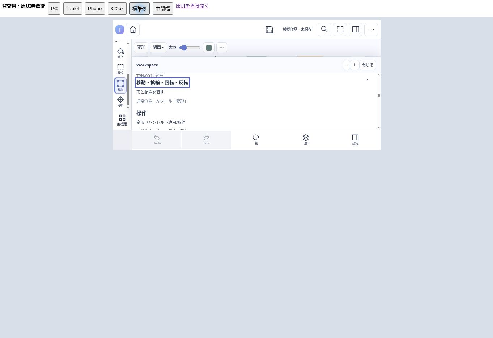
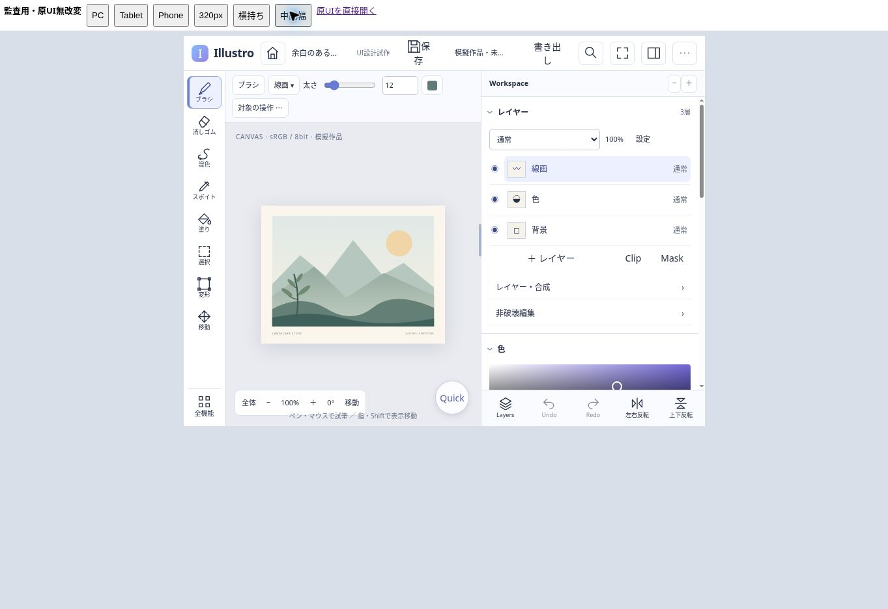
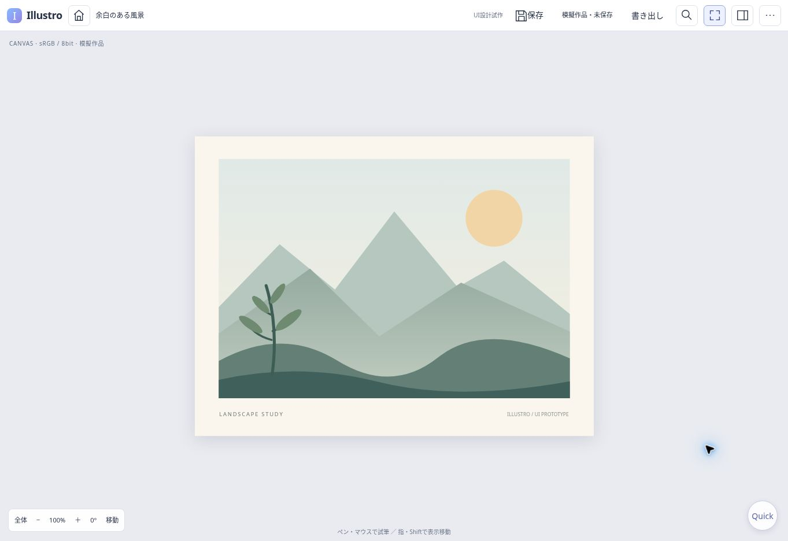

# 問題・改善提案一覧

対象：PR #7 `fc14afdde2d25ee61e2f05e4d89a387ab5ca3c04`。2026-10-31 UTC。P0=0 / P1=7 / P2=11 / P3=1、計19件。P1は製品出荷時の実損失を実測した意味ではなく、主要制作導線または実装前契約に対する影響の重大度。複数機能へ波及しても原因単位で一件として数える。

観測された試作不整合、コード/数学上の反例、設計上の不足を各項に明記した。技術方式未採用・実機未検証そのものは欠陥件数へ加えていない。特にAUD-006は単純overlayを採用済みと批判するものではなく、消去/下地依存筆の期待結果を先に決める必要があるという指摘。

[総合報告](illustro-design-audit.md) · [247機能台帳](feature-audit-matrix.md) · [再現用モデル](evidence/2026-10-31/adversarial-model.cjs) · [機械可読指摘](evidence/2026-10-31/findings.json)

## AUD-001 — P1 同じUndoが入口によって編集追加へ変わる

**確認段階：** 実操作・モデル反例。**対象ID：** HIS-001, LAY-001, CLP-001, UI-005。

**操作・反例：** 既存A→固定Undoなら0操作。A→検索HIS-001→設定・候補を試す→適用ではAと『Undo・Redo』の2操作になる。ブラウザーでは空履歴にもUndo・Redoが1操作追加された。

**影響：** Undoの学習が入口で破綻する。多義IDのadd/selectやcopy/cut/pasteでも単一kind駆動では意味を検証できない。製品データ破損の実測ではない。

**根拠：** qa/ui-prototype/model.js:35–39 / app.js:98。browser/search-undo-adds-operation.jpg、adversarial-model-results.json M01。

**原因/原因候補：** 機能IDと実行actionを分離する文書方針に対し、試作applyは機能分類だけでgeneric commitする。

**改善方向：** 検索結果をaction選択または同じ固定actionへ接続し、action別所有/副作用を宣言する。IDは保持する。

**副作用・トレードオフ：** 全247行へ巨大ボタンを増やす必要はない。副作用が異なる少数actionだけ明確化し、詳細閲覧は副作用なしに保つ。

**追加検証・閉鎖条件：** 固定/検索/Quick/Context/キーから同じactionと引数を実行し、最終状態と履歴を差分比較する。

## AUD-002 — P1 レイヤー構造・可視性が履歴の外で別管理される

**確認段階：** 実操作・コード確認。**対象ID：** LAY-001, LAY-002, HIS-001, SAV-003。

**操作・反例：** 3層→追加→Undoしても4層。線画の目OFF→色の行を選ぶと線画の目がONに戻る。

**影響：** 追加取消と視認結果が一致せず、ラフ→線画→着色フローの検証結果が信用できない。模擬保存もoperationIdsのみなので構造保存の証拠にはならない。

**根拠：** qa/ui-prototype/app.js:42–43,100–105 / model.js:20–23,43–54。browser/layer-state.json、layer-undo-state.jpg。

**原因/原因候補：** layerNamesはモデル外の配列、目状態はDOM属性のみ。renderLayersが全てtrueで再作成し、Undoはpast配列だけを移す。

**改善方向：** 試作でも最小の文書モデルに層ID/可視属性を持ち、追加/属性変更の前後状態をUndoする。

**副作用・トレードオフ：** 製品レンダラーは不要。模擬状態を増やす保守費はあるが、作品状態をDOMへ重複所有させない。

**追加検証・閉鎖条件：** 追加/表示切替/選択/Undo/Redoの順列と、保存対象の構造Snapshotを照合する。

## AUD-003 — P1 Sessionが存在するだけで作品Undoを占有する

**確認段階：** 実操作・モデル反例。**対象ID：** TRN-007, HIS-001, COL-001, UI-003。

**操作・反例：** 作品に2操作ある状態でCOL-001の設定候補を開くと固定Undoが無効。内部変更0件でも作品Undoへ切替する入口がない。別層Cを描いた場合も全Undo入口がSessionへ向く。

**影響：** 独立操作を続けられる設計に対して、次の取消判断で制作を止める。候補内Undoと作品Undoの意味を利用者が選べない。

**根拠：** qa/ui-prototype/app.js:71–80,98,155 / model.js:43–49。browser/undo-focus.json、M02。

**原因/原因候補：** Sessionの有無だけで全固定/Quick/キーUndoを振り分ける。model.undo(true)へのUI経路がない。

**改善方向：** 編集焦点に対応する履歴名を表示し、作品Undoへの明示切替を残す。設定値のローカル編集と文書Sessionも区別する。

**副作用・トレードオフ：** 常設のUndoボタンを大量追加せず、作用範囲ラベルと代替入口を比較評価する。

**追加検証・閉鎖条件：** 変形候補A→別層C→作品Undo/候補Undo/候補取消の全順序でCとAの履歴を別照合する。

## AUD-004 — P1 FocusのQuickから色・層を開いても表示されない

**確認段階：** 実操作・コード確認。**対象ID：** UI-004, UI-007, COL-001, LAY-001。

**操作・反例：** Focus→Quick→色。Quickは閉じるがframe.focusedが残り、dockはdisplay:none。層も同じshowPanel経路。

**影響：** 集中描画中の頻繁な色/層切替に、Focus解除という余計な操作が必要。押した結果も理解しにくい。

**根拠：** qa/ui-prototype/app.js:26,85,99,124 / style.css:8。browser/focus-color-hidden.jpg。

**原因/原因候補：** showPanelはclosedだけ解除し、focusedによる非表示を解決しない。

**改善方向：** Focus内の一時Panel提示か明示的なFocus解除を同じ入口で行い、閉じる時の戻り先を定義する。

**副作用・トレードオフ：** Panelを開くたびに作業配置を恒久変更しない。一時提示でCanvasを覆う量を測る。

**追加検証・閉鎖条件：** PC/Tablet/PhoneでFocus→色/層/検索→取消→描画再開を、キーボードなしで完遂する。

## AUD-005 — P1 文書なしで行う操作を共通Intent型が表現できない

**確認段階：** 設計上の反例。**対象ID：** CAN-001, SAV-001, SAV-002, UI-006, UI-008, AST-002, GST-002。

**操作・反例：** 起動直後Homeから新規作成、作品一覧検索、キー登録を要求する。ContextSnapshot.documentは省略可なのにIntentEnvelope.target.documentとbasisとcolorは全て必須。

**影響：** 作品状態と個人設定/作品管理を分ける所有モデルを、そのまま境界APIへ渡せない。架空文書を作ると文書寿命/Undo/保存への誤結合を誘う。

**根拠：** docs/product-architecture/contracts.d.ts:6–14,20–24 / PRODUCT_ARCHITECTURE.md §2。

**原因/原因候補：** document系の封筒をview/settings/assets/lifecycleまで一律に適用している。型案であり実障害は未実測だが、対抗例を有効に記述できない。

**改善方向：** scopeで判別するIntent union等にし、document操作だけにRevision/色/対象を要求する。これは提案であり正式型の変更は本監査ではしない。

**副作用・トレードオフ：** union分岐は増えるが、全フィールドoptionalにして検査を弱める案より誤対象を検出しやすい。

**追加検証・閉鎖条件：** 文書0件/1件/切替中のnew/open/settings/asset/paint/saveを型と可否の契約テストで照合する。

## AUD-006 — P1 後段描画の消去・下地依存筆の製品意味が未具体化

**確認段階：** 仕様欠落・限定反例。**対象ID：** TRN-008, BRU-001, WET-001, LAY-005, NDE-003。

**操作・反例：** 不透明原画→変形→見た目位置を消す→旧変形を移す。旧位置/新位置のどこに消去作用が残るか。混色筆の場合、旧変形変更で下地から再評価するか、採用済の見た目を保持するか。

**影響：** 後段に位置が残る通常色筆の説明だけでは、消去/Smudge/Mask/Alpha Lockの期待結果を実装者が一意に決められない。Undo/保存/効果順序にも波及する。

**根拠：** docs/product-planning/FINAL_PRODUCT_SPEC.md:43–49 / PRODUCT_ARCHITECTURE.md §7 / VALIDATION_AND_DECISIONS.md U08。M06。

**原因/原因候補：** 後段の物理格納は未定としてよいが、下地へ作用する演算と完成画素のどちらを正本として保持するかという意味が未分離。透明RGBAのsource-overだけでは不透明原画を消せない。

**改善方向：** paint/erase/smudge/Maskごとの合成と旧変形再編集時の期待像を先に定義し、演算/マスク/置換差分等を比較する。単純overlayを現採用方式だと断定しない。

**副作用・トレードオフ：** 演算保持は再評価費と版依存、確定結果保持は旧下地変更時の外観差、置換差分は容量が増える。UIを内部方式選択で複雑化しない。

**追加検証・閉鎖条件：** 折返しWarp/半透明/Clip/Maskの各条件で描く→消す/混ぜる→旧変形変更→Undo→Save/再開の期待画像を固定する。

## AUD-007 — P1 スマホWorkspaceが固定の適用・取消帯を覆う

**確認段階：** 実操作・画面・ヒットテスト。**対象ID：** DEV-003, DEV-004, TRN-001, SEL-001, UI-002, UI-003。

**操作・反例：** 740×360枠で変形を選択。自動表示された下部WorkspaceがSession帯へ重なる。固定適用の中心(401.6,281)のhitはボタンではなく上に重なるP要素。

**影響：** 確定/取消を直感的に使えず、シートを一度閉じるか詳細内の末尾までスクロールする必要がある。内容のプレビューも覆う。完全到達不能とまでは主張しない。

**根拠：** qa/ui-prototype/style.css:5–6,10 / shell.html:21。browser/landscape-session.jpg、session-occlusion.json。UI_NAVIGATION.md §4は『画面変更で隠さない』。

**原因/原因候補：** stage内Session帯に対しdockはz-index:8で同じ下端を使い、コンパクト時の所有/配置が統合されていない。

**改善方向：** シートとSessionで一つの固定操作帯を共有するか、衝突しない予約領域に配置する。

**副作用・トレードオフ：** 操作帯分の高さは必要。単純にz-indexだけ上げるとPanelの入力/閉じるを塞ぐため、占有計算を一本化する。

**追加検証・閉鎖条件：** 390×844/320×568/740×360、仮想キーボード、文字拡大で対象・候補・適用・取消の可視性とhitを検査する。

## AUD-008 — P2 目的・操作語検索で主要機能を発見しにくい

**確認段階：** モデル実行。**対象ID：** UI-005, CAN-003, LAY-002, LAY-004, IO-002。

**操作・反例：** 『乗算』『クリップ』『透明PNG』は0件。『左右反転』はUI-006（Workspace左右反転）のみで、Canvas表示/作品反転が出ない。ID検索247件成功とは別の事実。

**影響：** 名前を知らない利用者が主要な制作操作を発見できず、候補を誤解しやすい。

**根拠：** qa/ui-prototype/model.js:8–11 / FEATURE_ACCESS_LEDGER.json discovery。search-tests.json。

**原因/原因候補：** ID/名称/分野/discoveryへの連続部分文字列一致のみ。作用対象と別名、表記揺れ、パラメータ語を網羅していない。

**改善方向：** 対象を伴う別名辞書と安全なaction候補を持ち、通常位置/意味を検索結果に併記する。

**副作用・トレードオフ：** 曖昧な検索を勝手に実行しない。候補数増大と誤上位を目的課題で評価する。

**追加検証・閉鎖条件：** 名称を教えない制作課題と、反転/Clip/Multiply/透明出力の同義語セットで到達先を照合する。

## AUD-009 — P2 詳細の閉じる/Escapeが定義した焦点復帰を守らない

**確認段階：** 実操作・コード確認。**対象ID：** A11-003, UI-005, UI-008。

**操作・反例：** 検索→COL-001詳細→候補なしでEscapeを押しても詳細が残る。×で閉じるとactiveElementはBODYになり、元の検索入口へ戻らない。

**影響：** キーボード/支援操作で作業位置を見失い、再探索が必要。スクリーンリーダー実機での影響は未検証。

**根拠：** qa/ui-prototype/app.js:52,94,154。browser/undo-focus.json。UI_NAVIGATION.md §3。

**原因/原因候補：** 詳細表示の復帰先を保存せずinnerHTMLを消す。Escape処理は浮動UI/Session/Focusのみ扱う。

**改善方向：** 詳細入口と戻り先を管理し、候補取消と詳細を閉じる優先順位を一貫させる。

**副作用・トレードオフ：** 非同期完了時に勝手に焦点を奪わず、入口消滅時だけ安全な代替へ戻す。

**追加検証・閉鎖条件：** 検索/カテゴリ/関連/直接入口→詳細→閉じる/EscapeをTab順とactiveElementで確認する。

## AUD-010 — P2 手数台帳が実入口や開始条件を正確に表していない

**確認段階：** 台帳・DOM対応の反例。**対象ID：** LAY-004, LAY-005, CAN-002, BRU-008, UI-005。

**操作・反例：** LAY-004/005は初期WorkspaceにClip/Maskの直接ボタンがあるのに3手の分類経路だけを主入口として記録。BRU-008も直接リンク。225件が一律3手、PC/Tabletは247件同一配列。

**影響：** 直接機能が遅いと誤評価する一方、閉じたBoxを開く/スクロール/候補開始を落として短く評価し得る。完成までの手数ではない旨は既存資料に正しく明記されている。

**根拠：** FEATURE_ACCESS_LEDGER.json steps / qa/ui-prototype/app.js:29,31 / UI_NAVIGATION.md §3。static-results.json。

**原因/原因候補：** 汎用のBox→分類→機能を主導線へ割当て、可視状態と実DOM部品を検査していない。重複文章自体を欠陥とする指摘ではない。

**改善方向：** 最短/通常/発見の入口を分け、開始画面・Box開閉・スクロール・候補開始までの実経路を記録する。

**副作用・トレードオフ：** 全件のクリック数だけを最適化せず、対象確認・移動距離・遮蔽も併記する。

**追加検証・閉鎖条件：** 初期/閉Workspace/Focus/小画面から同じ目標へ到達し、記録と実DOM操作を差分比較する。

## AUD-011 — P2 二指Zoom/Rotateが重心をアンカーにしない

**確認段階：** コード・数学反例（実タッチ未試験）。**対象ID：** CAN-002, INP-004, GST-001, DEV-002。

**操作・反例：** art中心500、指重心700、重心を動かさず2倍Zoom。現式はパン差0で点700を900へ動かし、200pxドリフトする。

**影響：** 見たい箇所が指から逃げ、ペンと指の併用で再パンが必要。実機での遅延/誤差量を測定した主張ではない。

**根拠：** qa/ui-prototype/app.js:134,137–149 / style.css:5。M05。旧UI brushSurface.ts:76–81はzoomAt/rotateAtを重心で行う。

**原因/原因候補：** 中心基準のCSS拡縮に対し重心移動差しかtranslationへ足さず、Zoom/Rotateによるアンカー補償がない。

**改善方向：** View行列で前重心の文書点を保持し、新姿勢へ写してtranslationを補正する。

**副作用・トレードオフ：** 二指→一指や反転後の再基準化も必要。旧コード全体への回帰を求めない。

**追加検証・閉鎖条件：** 中心/四隅で固定重心Zoom/Rotateし、アンカー文書点の再投影誤差を数値検査。実ペン+指で操作感を別評価する。

## AUD-012 — P2 状態更新が全試筆SVGの再生成を呼ぶ

**確認段階：** コード上の負荷経路。**対象ID：** HIS-001, SAV-004, UI-004, BRU-009。

**操作・反例：** 試筆が増えた状態で候補入力/Quick表示/模擬保存進捗がsyncを呼ぶと、pastの全pathを文字列化しdemoStrokes.innerHTMLを置換する。

**影響：** 長時間UI検証に状態確認自身の描画コストが混入する。製品の全画素再計算や実機カクつきが発生したと断定するものではない。

**根拠：** qa/ui-prototype/app.js:71–82,152。PRODUCT_ARCHITECTURE.md §5の非侵襲契約。

**原因/原因候補：** 監視/Undo可否/表示更新を一つのsyncへ集約。モデルだけの画素API不在検査ではapp側DOM負荷を検出しない。

**改善方向：** 状態表示と描線差分更新を分け、関連する文書差分時だけ再構築する。

**副作用・トレードオフ：** 小規模試作には簡単だが、性能Labと混同しない。最適化に過大な製品実装を持ち込まない。

**追加検証・閉鎖条件：** 同じ入力系列を短/長履歴、監視ON/OFFで比較し、DOM置換/処理時間を別計測する。

## AUD-013 — P2 既存の入口試験はactionとDOM状態の一致を検査しない

**確認段階：** 試験設計の盲点。**対象ID：** UI-005, HIS-001, LAY-001, LAY-002。

**操作・反例：** 247×4入口はnavigateへ異なる文字列を渡すだけで、entry値は許可一覧の検査以外に使われない。主入口のDOMや実行結果は比較しない。

**影響：** 988成功を操作等価性や制作完遂の根拠にできない。既存テストはNo browser/device assertionと限界を明記しており、虚偽の実機報告をしたという指摘ではない。

**根拠：** qa/ui-prototype/tests.cjs:11–16 / model.js:13–18 / tools/validate_ui_design.py。既存12試験は再実行して成功、一方M01/実DOMで反例。

**原因/原因候補：** メタデータ整合性と行動の等価性の検査が分かれていない。

**改善方向：** ID網羅試験を残し、action別の期待状態とDOM経路の代表対抗試験を追加する。全247処理本体の実装を要求しない。

**副作用・トレードオフ：** DOM試験増加の保守費があるため、共有部品と高リスクactionの組合せで選ぶ。

**追加検証・閉鎖条件：** AUD-001/002/003/004/007の回帰が既存試験に追加され、修正前に失敗することを確認する。

## AUD-014 — P2 接地中の入力資源不足と受理境界が未具体化

**確認段階：** 設計上の境界条件。**対象ID：** INP-001, INP-005, BRU-009, DEV-005, SAV-006。

**操作・反例：** 接地でwriterを取得し、長筆の途中に保持可能容量へ達する。離筆で一Transaction受理を閉じる記述と『次の編集の受理前に拒否』だけでは、今回の入力をどこまで保護/受理したか一意でない。

**影響：** 極端な長筆/低メモリ時に、既受理入力の喪失防止と誠実な不能表示の境界が実装者依存になる。通常利用で必ず枯渇すると主張しない。

**根拠：** PRODUCT_ARCHITECTURE.md §3–4 / UNIFIED_SYSTEM_DESIGN.md U04/U06。

**原因/原因候補：** Job予約は定義されたが、入力writerの増分予約/未受理データ寿命と中断表示が未記述。

**改善方向：** 接地時の最低予約、増分チャンクの保護、足りない時の入力保持/候補停止/救出を設計する。具体容量は実測で決める。

**副作用・トレードオフ：** 過大予約は初筆を拒否しやすく、細かすぎる予約は固定費。部分筆の自動確定はUndo意味変更なので勝手に採用しない。

**追加検証・閉鎖条件：** 長筆の途中で入力/退避/完了先の各予算を枯渇させ、受理範囲と救出可能データを照合する。

## AUD-015 — P2 受理済Jobの恒久失敗から依存履歴・保存を収束させる手順が不足

**確認段階：** 設計上の反例。**対象ID：** HIS-001, SAV-003, SAV-006, FIL-001, AUT-003。

**操作・反例：** Aを受理→A依存B→独立C→Save(A+B+C)→Aが復元不能な失敗。取消の原則はあるが、再試行不能時の保存失敗、A/Bを除く新枝、C保持、再保存の具体的な遷移/対象表示がない。

**影響：** 単一失敗を全作品ロック/全体巻戻しへ短絡する危険。現時点でデータが壊れたという観測ではない。

**根拠：** contracts.d.ts Transaction.materialization:'failed' / FLOWS_AND_STATES.md §4–5 / NONBLOCKING_OPERATION_CONTRACTS.md §全操作5。

**原因/原因候補：** 正常/Undo/保存交錯は詳細だが、失敗状態からの出口と依存連鎖の解決が受入表へ接続されていない。

**改善方向：** retry可能/不能、currentとSaveFence各用途の失敗、依存取消同意、独立枝保持、コピー救出の状態表を作る。

**副作用・トレードオフ：** 全Jobエラーへ確認を乱発せず、影響する作者意図の単位で一度だけ解決する。

**追加検証・閉鎖条件：** 一時エラー→再試行成功と恒久失敗→依存Bのみ取消→C保持→旧Save失敗/新Save成功を別試験にする。

## AUD-016 — P2 作品以外の名前付きUndoの作用先が統合入力契約から抜ける

**確認段階：** 資料間の具体化不足。**対象ID：** WET-006, REF-001, REF-002, BRU-005, TRN-007, HIS-001。

**操作・反例：** 試筆パッドに描く→資料を動かす→変形Session→固定Undo。各仕様はパッド独立/資料名前付きUndo/内部Undoを要求するが、どの焦点・対象でどの履歴へ届くかの統合規則がない。

**影響：** 文書画素/資料配置/試筆/Session値の混同と、戻したい対象を取り違える認知負荷が残る。

**根拠：** features/WET.md WET-006、features/REF.md REF-001/002 / PRODUCT_ARCHITECTURE.md §2 / FLOWS_AND_STATES.md 状態軸。

**原因/原因候補：** 所有先一覧と『Session/作品』二分だけでは、複数編集領域の履歴ルーティングを説明できない。

**改善方向：** 履歴scopeと焦点、作用名、明示切替、領域を閉じた後の戻り先を統合表で定義する。

**副作用・トレードオフ：** Undoを全領域で常時増殖させず、通常は焦点から決め、名称と代替で誤認を防ぐ。

**追加検証・閉鎖条件：** パッド/資料/作品/Sessionを交互に編集し、各Undo後に対象と残存編集を利用者が説明できるか評価する。

## AUD-017 — P2 中間幅でWorkspaceがCanvasを過度に圧迫する

**確認段階：** 画面・DOM寸法。**対象ID：** DEV-004, DEV-002, UI-002, UI-006。

**操作・反例：** 800×600、初期344px Workspace。Rail64px、描画面392×466px。Workspaceは画面幅43%、描画面積は全枠の約38.1%。760px以下の自動シートへは切り替わらない。

**影響：** 縦持ち/分割窓で中央の広いCanvasという目的が弱くなる。ユーザーが閉じれば広がるが、その必要を毎回負担する。

**根拠：** style.css:1,5–6,9–10 / UI_NAVIGATION.md §5。browser/intermediate-800.jpg、intermediate-metrics.json。

**原因/原因候補：** 試作の幅閾値と固定右幅に、Canvasの最低作業幅/面積の条件が接続されていない。

**改善方向：** 端末名でなく残余Canvas幅と利用者の開閉意図を基準に、狭い幅/一時シート/閉じるを比較する。

**副作用・トレードオフ：** 自動折畳は筋肉記憶を損ね得る。既定Box順を変えず、手動状態と復帰を保持する。

**追加検証・閉鎖条件：** 760px境界前後と800/960/1180pxで、同じ制作課題の遮蔽率/開閉回数/探索時間を比較する。

## AUD-018 — P2 主要な色面が操作可能に見える静的装飾になっている

**確認段階：** 実操作・コード・画面。**対象ID：** COL-001, UI-001, DEV-002。

**操作・反例：** 右の大きな色面と白い選択リングを押す/動かそうとしても、divはaria-hiddenで値を持たず、色変更は隣の小さいnative color inputか色チップから行う。

**影響：** 最頻出の採色UIで初見の期待と実操作がずれる。色計算本体未実装の欠陥ではなく、現在の試作で触れる場所が識別できない問題。

**根拠：** app.js:30 / style.css:6 .color-plane / browser/tablet-workspace.jpg。 browser/color-plane.jsonで色面をクリック後も#637b78と焦点未取得を確認。

**原因/原因候補：** 操作部品に見える装飾と、実際の試行入口に視覚的な区別がない。

**改善方向：** 最小の色選択操作を接続するか、現試作の操作入口を明示し、装飾を操作部品のように見せない。

**副作用・トレードオフ：** 製品の色管理エンジンまで実装する必要はない。警告文の追加で制作画面を埋めない。

**追加検証・閉鎖条件：** 説明なしで色を変える課題を与え、最初に触る場所と成功/無反応を記録する。

## AUD-019 — P3 Touch標的の例外評価と320px端の余白が不足

**確認段階：** DOM寸法・設計推奨との差。**対象ID：** A11-002, DEV-002, DEV-003, DEV-004。

**操作・反例：** Tabletの現在色33×30px、対象帯の高さ30px。320pxではreviewボタンx288+幅38=326で右端6pxが枠外。44px推奨に対する等価代替/例外の実測記録がない。

**影響：** 指での誤押下や端部の窮屈さの可能性。WCAG違反や実利用の失敗率を断定しない。44pxは設計推奨で、24px最小と同一ではない。

**根拠：** browser/tablet-metrics.json、small-320-metrics.json、small-320.jpg / QUALITY_REQUIREMENTS.md末尾。

**原因/原因候補：** PC密度の制御がTabletへ共通投影され、最小幅でヘッダー固定項目の総幅が収まらない。

**改善方向：** Touch時のhit領域と可視制御の等価代替を評価し、端部の配置を収める。

**副作用・トレードオフ：** 全ボタンの単純拡大はCanvasを圧迫する。主要Touch経路から優先し、例外を根拠付きにする。

**追加検証・閉鎖条件：** 実指で誤押下率と移動距離を測り、320px/200%文字/左右利きで主要入口の可視性を検査する。

## 再現と証跡の注意

`node docs/audits/evidence/2026-10-31/adversarial-model.cjs` は対象モデルを読み込むだけで変更しない。M01/M02は期待契約と異なる結果を記録する。M03/M04は保存時点固定と独立編集保持の肯定確認。M05/M06は数学反例、M07は容量算術であり、GPU/実機の測定ではない。ブラウザー証跡は原HTMLのbyteコピーを起動して取得した。

