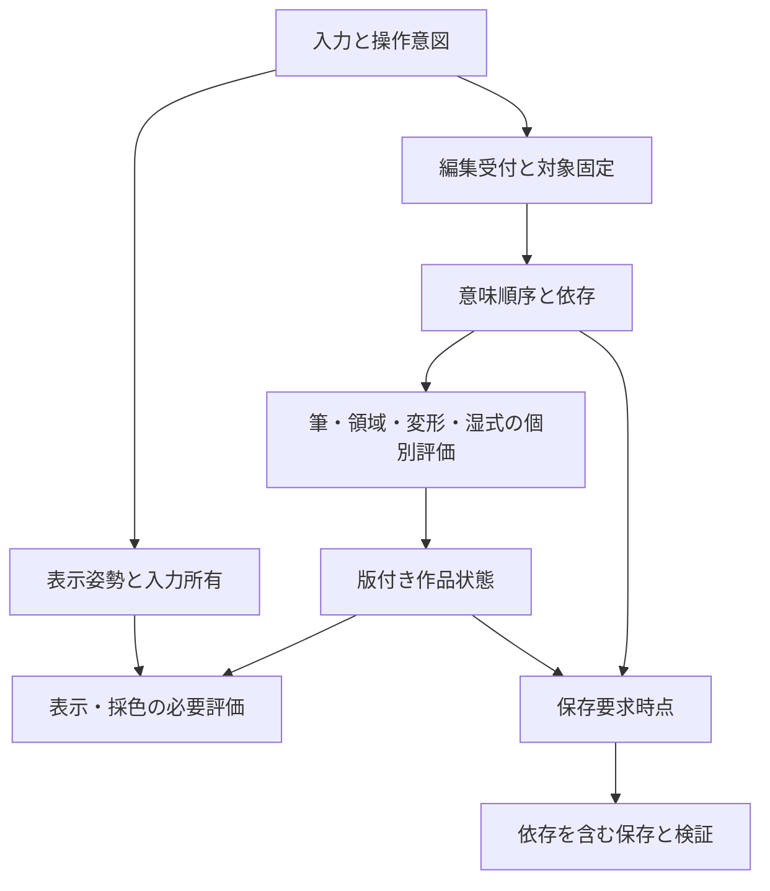

# 全体統合の比較設計 — 正式アーキテクチャではない

**現在地：方式比較まで進めた研究候補。正式採用・製品実装は未実施。**

主案はR02の依存順序、R05の需要評価、R07の固定保存時点を接続し、R01/R06が体験を成立させるか検証する構成。UI/領域/湿式を一つの万能アルゴリズムへ統合しない。採用判断は[台帳](DECISIONS.md)と試験結果を経て行う。

## 共通化する境界と独立して残す部分

- 共通：作品/対象/版/操作ID、明示的な状態遷移、参照依存、必要資源、色/α契約、固定保存境界。
- 個別：筆の被覆と蓄積、湿式solver、線画位相、文字組版、warp、codec。これらの計算原理を共通化する理由はない。
- 入力の各点を汎用Commandとして配布し全UIを更新する案は避ける。高頻度筆入力は筆セッションへ保持し、意味ある一筆/設定/ハンドル操作を履歴境界にする候補。
- 広く共有する仕組みの障害範囲は大きい。R02/07/08は正しさoracleと故障試験を先に備える。plugin/AI/3Dは本体の成立に必須化しない。

## R02候補の実装可能な意味仕様

### 最小レコード

`Intent = {document_id, operation_id, admission_seq, target_id, target_generation, kind, parameter_version, read_dependencies, write_scope, resource_versions, status}`。

`status`は接触中/受理済/依存待ち/評価中/確定/取消/失敗。未適用の変形等は別のsessionで、候補パラメータ版を持つ。`admission_seq`はユーザー操作の意味順であり、スレッド開始順/完了時刻ではない。

画面のview epoch、文書の内容版、対象の生存世代を同じ番号にしない。表示姿勢が変わっただけで受理済筆を古い結果として捨てない。削除済対象の結果を別の現選択へ適用もしない。

### 受付から確定

1. 筆開始で文書・描画対象・選択・ガイド・筆/紙資源の版を束縛。設定変更は次筆用に保持。実センサーと予測は別列にする。
2. 離筆受理でoperationを封じ、意図順序へ入れる。未完の計算はその後もoperationに帰属。通常筆へ適用確認を追加しない。
3. `W_i ∩ (R_j ∪ W_j)` または `R_i ∩ W_j` が空でない先行操作iから後続jへ依存を付ける。構造変更/下地参照/global演算は保守的に広く宣言。局所性を証明できない操作を狭い領域と偽らない。
4. 依存を満たすjobを予算内で評価する。候補の古い設定版は新設定へpublish不可。一方、**受理済の古い筆は必要な操作なので完成が遅くても破棄不可**。
5. 作品上に同時に見せる状態は依存を満たした整合した集合にする。部分的に完成したから下地/Maskだけ新しい不整合像を最新確定像にしない。
6. 操作の効果がないと判定できる場合、計算jobは省けるが受付記録/利用者への結果は残す。履歴に入れるno-opの意味は操作種類ごとに詰める。

依存集合が正しければ独立操作は可換という条件付き設計。実brush/効果/構造に対する依存宣言の正しさは未検証。E01はこの条件下の整数操作だけを試す。

### 取消とUndo

- 未適用session取消はsession差分だけを捨てる。全作品の開始rootへ戻さない。
- 受理済通常操作のUndoは意図順の対象を指定。結果が未完でも取消状態を先に記録し、後から届く計算を再出現させない。
- 先行結果を読んだ未確定操作がある場合、依存閉包を列挙し「依存分も取消/元操作を維持」。勝手に下地だけ除いて同じ後続結果を流用しない。
- 対象削除も順序上の操作。削除前のSnapshot/保存へ必要な筆は過去対象版に残し、現在の削除対象へ復活させない。現在の生存判定だけで過去の必要結果を捨てない。
- 変形/文字内部のUndoはsession意図列へ、適用後は作品の一操作へ。ボタン/キー/gestureが同じ対象を指すことを試験する。

## R05候補の評価仕様

演算は `InputDomain(output_rect, params, input_versions)`、`AffectedOutput(changed_input, params)`、`ColorContract`、`IdentityCondition`、`TemporaryBudget`、`CancellableBoundary` を宣言する候補。

- 点ごとの色調：同じ出力範囲が入力。恒等を条件付き省略。LUT/カーブ融合は精度誤差を検証。
- 有限半径blur：出力を半径分広げて入力を読む。出力Maskの外の色もblur入力になる。Gaussian打切り半径と誤差はパラメータに含め、無限supportとの同一性を主張しない。
- 放射/変位/warp：逆写像した軌道/範囲を入力とする。上界不明なら全入力扱い。出力矩形周辺だけの読込は禁止。
- histogram/全体統計：全入力の版に依存。局所表示へ使う統計でも全体性を隠さない。統計表示の更新と作品確定は別。
- 通過Group/階調合成：下地を依存に含める。選択層だけの独立flattenが同値かは一般には保証しない。
- cacheのキーは入力版、演算版、パラメータ、色空間/深度/α、座標、境界規則、必要なら近似段階。cacheは破棄しても正本から再生成可能なものだけ。
- 解像度別の表示は品質階級を明示。export/採色/厳密比較が画面用の低精度結果を誤利用しない。

作成する順番を固定する仕様ではない。同じ演算意味に対して一括/分割/共有のコストを比較する境界の提案。

## R04候補の境界判断データ

`RegionVersion`には生成元Raster/Vectorの版、境界候補、接続関係、面/穴/外側、確認状態を持つ候補。永続面IDの規則は未決。

人の修正は `Constraint = {kind, source_anchors, local_geometry, source_version, author_decision, validity}` として独立保持する案。kindは接続/切断/接続拒否/同面。元線が変わるとアンカー対応を再検証する。対応が曖昧なら保留として差分に残す。距離が近いという理由だけで別の線へ移植しない。

面更新は、幾何変更→接続変更→影響する面集合→旧手修正との照合→候補という順の比較対象。全体探索へ広がった時は全体化を認める。E03で固定半径更新が不十分な反例を確認した。旧版のFill/Selection参照は維持し、既存色を自動再配分しない。

## R07候補の保存時点と状態

- `SaveFence = {document_id, request_id, last_admitted_seq, named_root, pending_sessions, format, destination_generation}`。
- fence以前の受理済離筆の必要結果と全依存を固定する。fence後の筆は現制作へ進め、保存物へ混ぜない。現在版を読みながら順次保存しない。
- 確定rootの依存にはSC-01のCanvas/外側内容/層/Mask/選択/Vector/Text/ICC/資源/領域判断/湿式停止状態/固定案/カンプ/記録/資料/文書metadataを含む。Workspace個人設定と文書metadataの含有は原仕様の用途別扱いを保持。
- 接地中筆/未適用変形等はRecoveryの保留として別。画像exportには無言採用しない。
- 保護は追記データ→hash/構造検査→完全manifest→世代公開→再読込検査という候補。ファイル/APIによる耐久性の違いを能力として記録。旧正常世代は公開完了まで保持。
- 入力のsemanticログだけ先に記録できても、必要なエンジン/資源/実行状態で復元検証できなければ「作品全体保護済」と呼ばない。再現できたprefixと救出候補を別表示。
- 持出保存の完了と端末内保護は独立。request_idと対象版を成功通知へ付け、後続変更を未保存として残す。

## データ表現を固定しない比較

| 表現 | 有利な条件 | 破綻条件/負担 | 必要試験 |
|---|---|---|---|
| 密な画素配列 | 小作品、全面加工、連続メモリアクセス | 空層/巨大余白/複製、全量copy | 小作品の固定費と大作品peak |
| 疎な矩形片/Tile | 局所筆、多層空白、外側保持、差分履歴 | 散布で面全体をtouch、小片metadata、大片過剰確保 | 64/128/256/512候補等の広い比較。E05はpayloadのみ |
| 元内容+効果/変換graph | 同じ元の再編集/別案、恒等省略 | 深いgraph、広い参照、cache thrash | 長時間の再編集/保存/復元を含む |
| 境界/制約/面構造 | 領域修正と同版の再利用 | 不安定な交差、全域位相変化、曖昧な手修正対応 | 正解付き位相データと人の修正総時間 |
| 媒体状態+作品内進行 | 停止/再開可能な水彩 | 状態量、順序依存、端末数値差 | 再開後も含む保存/Undoの同一性 |

複数表現が必要でも、その存在を常時二重の全画像にする必要はない。正本と再生成可能な派生物の境界を各能力が宣言する。

## 同時操作の矛盾検査

| 併走例 | 共有/順序条件 | 衝突・副作用の解決候補 |
|---|---|---|
| 太筆確定+指ナビ | 入力時刻と表示変換、同じ文書空間 | UIと画素jobを分けてもGPU/主スレッド占有が長ければ失敗。小仕事化を測る |
| Fill+同層後続筆 | Fillの参照版、出力との非可換順序 | 筆を受理し依存待ち。別層でも下地を読むなら独立とは限らない |
| 領域更新+元線変更+塗り | 旧確認済み版と新候補を分離 | 旧版塗りを保持、新候補は明示採用。手修正移植の曖昧さを出す |
| 効果調整+別層筆+取消 | 別層が効果の下地かを確認 | 見かけの別層を独立と決めつけない。取消は候補寄与のみ |
| 変形+元内容描画 | 逆写像の成立、結果層との関係 | 原仕様の内容編集/新層/明示焼込の局所選択。自動変換しない |
| Undo連打+新筆 | 意図上の履歴位置と依存 | 新筆は要求した履歴位置の後へ。計算が遅いから末尾へ戻さない |
| 保存+湿式進行 | 同じ停止時点の色と媒体 | 保存rootを固定。壁時計で保存像を変えない |
| 保存+履歴GC+素材削除 | 保存中pin/固定案/記録の到達依存 | 正本は回収しない。pin増大は予算へ返し派生cacheから減らす |
| 資料decode+動画出力+筆 | CPU/GPU/一時memory/転送予算 | 大jobの同時数を制限、codec等の分割不能仕事を検出。入力・保護の飢餓を監視 |
| 検査Proof/Solo+export | 表示用状態と出力用途 | Proof/UI/資料非混入。Solo出力は原仕様どおり選択を求める |
| 仮想化層一覧+支援技術 | 選択Identityと読み上げ対象 | 行非表示でも意味上の対象と焦点を保ち実支援技術で検査 |

## 資源限界・長時間・飢餓

入力/ナビ、現在の筆、保護、可視評価、独立編集、資料/候補/動画/先読みの仕事を区別する。ただし優先度だけでは既に実行中の大jobを中断できない。分割点と一時容量予約を合わせる候補を比較する。E02の小分け効果は抽象serverでありGPUのpreemption保証ではない。

平均throughputが入力需要より小さい状態を無限時間続けて、無限入力受付・有限memory・欠落ゼロ・確定遅れ有界を同時保証することはできない。対策候補は不要仕事除去、派生cache回収、独立jobの入場制御、保護可能な受理入力の退避。それでも限界なら新編集開始前に局所説明し、ナビ/救出を維持する。すでに受理した筆を落として応答達成としない。

保存を完全idle時だけにしない。最古未保護操作の年齢と資源予約を監視し、保護が永久飢餓にならない下限配分を試験する。電池/発熱で演算速度が下がる条件も入れる。24時間未測定を長時間合格としない。
