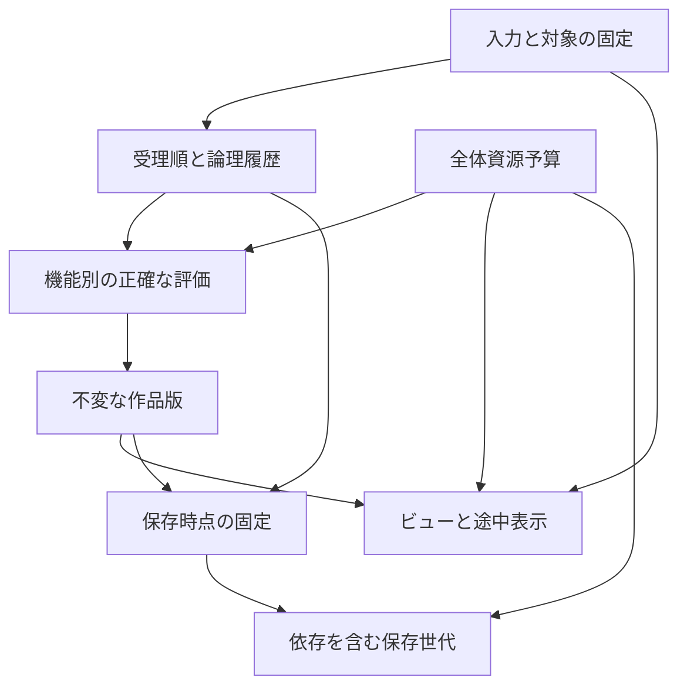

# Illustro 統合システム基本設計

2026-10-30 JST。対象：30分野247 ID。基準：研究HEAD `26423662192ed05b1d1c535cd15091f17d52d0bd`、PR #1 `92daaf5ac23a015a834141f7d08275d903711404`。

**統合基本設計の原稿は2026-10-30に完了。** 後続の[製品仕様確定版](../product-planning/FINAL_PRODUCT_SPEC.md)でD01/D02/D03/D05の製品意味と247機能の採否を設計採用した。以下のU09/U10の「推奨・承認待ち」は**統合設計作成時点の経緯**であり、製品範囲は最新の確定版を優先する。アルゴリズム採用・詳細設計・実測・個別承認まで完了した意味ではない。後続の[技術未決定台帳](OPEN_DECISIONS.md)を併読する。

入口：[監査](INTEGRATION_AUDIT.md) → [全機能への接続](FEATURE_INTEGRATION_MAP.md) → 本書 → [最終レビュー](INTEGRATION_FINAL_REVIEW.md)。元の製品仕様と14個別方針は変更しない。

## U01 — 境界と所有者

| 系統 | 所有する情報・責務 | 参照・依存 | 所有しない情報 |
|---|---|---|---|
| 入力・Pointer | 接触ID/生存世代、接触ごとの役割、観測サンプル、一時ツール、キー/IME所有 | 表示変換の時刻対応、対象選択、機器能力 | 作品画素、保存成功判定 |
| View/Presentation | ビュー別姿勢、途中表示、品質段階、公開スナップショット | 不変作品版、仮線/仮画像、表示色変換 | 正式画素や作品Undo |
| 操作受付 | 文書/操作ID、受理順、対象、必要資源版、論理履歴位置 | 入力意図、各機能の読書き条件 | ブラシ/位相/codecの演算内容 |
| ブラシ | 意味的筆定義、筆設定/seed/選択/ガイドの固定、筆内状態、正確な差分評価 | 入力、原画素、色契約、タイル、資源予約 | UIの現在選択を後から読み直す権限 |
| Document | 文書属性、層ツリー、画素/Mask/パス/文字、効果/変形定義、依存資源参照 | 不変データ保管、操作の正式結果 | GPU表示Textureを唯一の正本とすること |
| タイル・画像評価 | 入出力域、境界、演算意味、タイル内部分/全体評価、依存版 | 原本、色契約、資源管理、演算別の評価器 | 全機能を同じアルゴリズムへ強制すること |
| CPU/GPU実行 | 予約済仕事の投入・完了・失敗、転送/実行中資源の寿命 | 評価器、資源予算、Device世代 | ユーザー操作順の独断変更 |
| キャッシュ・メモリ | 派生物、常駐先、予約、一時容量、回収、需要準備 | 正本の到達根、Jobの利用中参照 | 受理済筆/固定案の無言破棄 |
| 履歴・Revision | 意図単位Transaction、論理カーソル、不変根、Redo経路、分岐/固定案 | 操作受付、結果参照、保持方針 | Recovery済みという推定 |
| 保存・Recovery | 固定保存境界、正常世代、永続化確認、保留の別記録、競合検出 | 不変根と到達依存、履歴、保存先能力 | Undoの有無だけでの保存成功判定 |
| 変形・効果Session | 固定原本、候補設定版、内部Undo、適用/取消、入力依存 | 正本、タイル評価、対象座標、表示 | 他対象で成立した編集の全体巻戻し |
| 線画・領域 | 原線の版、仮想境界、作者制約、確認済区分と新候補 | Raster/Vector原本、位相照会 | 独立した塗りや選択の自動書換え |
| Fill/Selection | 固定参照版、種点/軌跡/囲い、出力画素または濃度Mask | 領域照会、通常色差探索、選択/保護条件 | 領域解析結果そのものの所有権 |
| 色管理 | Documentの色/深度/α/合成意味の契約、入力/表示/出力の変換境界 | 各評価器と形式能力 | 新規既定値の承認の代行 |
| 入出力 | 形式別能力、段階読込/符号化、損失説明、コピー先の結果 | 固定版、色管理、資源予算、外部権限 | Native保存の全編集性保証の代用 |
| UI/操作状態 | 固定入口、対象帯、選択、フォーカス、到達可能な補助UI | 同じ意味Commandの可否、Sessionの範囲 | 作品と別のUndo意味を入口ごとに創設すること |
| 高度機能管理 | 軽い宣言、起動/活動/停止/回収、使用中依存 | 需要、資源管理、任意の外部Job | 未使用時の重い周期演算・通信 |
| Assets | 種別付き素材Identity/版/依存、個人庫と作品使用版の解決 | 入出力、到達根、資源予約 | 名前だけでの旧版置換 |
| VectorText/Guide | パス/文字/書式/ガイドの編集正本、IME境界、吸着の意味 | Document、入力、色、専用評価器 | glyphやガイド表示線を正本とすること |
| Clipboard | 内部コピーの原本/ICC/座標/移送ID対応、Cut成功境界 | 入出力、到達根、Transaction | OS権限成功を内部copyの必須条件にすること |
| Recorder | 記録区間/依存/公開除外、活動時間、動画要求 | 確定作品イベント、履歴とは別の保持根、入出力 | 未使用時録画、記録停止による過去データの削除 |

所有は論理責務であり、Worker数、プロセス数、クラス分割の指定ではない。高頻度の各ペンサンプルを汎用Commandとして全系統へ通知しない。

## U02 — 正本・派生物・耐久性を別の軸にする

| 種類 | 例 | 回収・再構築条件 |
|---|---|---|
| 作品の正本 | 確定Rasterタイル、パス、文字/書式、Mask、原本と効果/変形、ICC、外側内容、作者の境界判断 | 現作品/履歴/固定案/保存中などの到達根から必要な間は保護 |
| 受理済みで未確定の編集入力 | 軌跡、筆版/seed、対象、順序、必要な下地版と状態 | 唯一の作者情報を含む。正確な結果または検証可能な復元情報へ移るまで捨てない |
| 未適用Session | 変形候補、塗り調整、IME途中、効果候補 | 正式像と別。取消はこの寄与のみ。Recovery保留の可否/保存範囲を別記録 |
| 再生成可能な派生物 | Mip、合成/変形表示、glyph、サムネイル、解析の未承認候補 | 正しい原本・資源・評価器から再生成できるときだけ回収可能 |
| 個人設定・周辺データ | Workspace/キー、個人素材、作業時間、資料、記録 | 作品画素と別の保存/公開範囲。派生物とは限らない |

「GPU上」「CPU上」「保存済み」は分類名ではない。CPU上の唯一の未保護画素も正本であり、ストレージ上の縮小像も派生物である。GPUで結果を生成した場合、正確な回収可能コピー/確実な再構築元を保つまではそのGPU割当を捨てない。Device lossで失われ得る唯一の確定結果を残さない構造を必須条件にする。CPUへ毎フレーム全面コピーする指定ではなく、変更ブロックと保護境界で移送する。

R07の「描画済み画像主体」はRaster通常起動の全筆再演禁止である。文字・ベクター・ライブ効果まで画像1枚へ変換する意味ではない。再編集原本はUndo保持期限と独立に保存する。

## U03 — 版と結果の公開条件

論理レコードは次を分ける。物理schemaは詳細設計で選ぶ。

- Document IDと生存世代、Target IDと世代：文書切替/削除/同名新設で誤対象にしない。
- Operation ID、受理順、Transaction ID、論理履歴カーソル：計算の開始/完了時刻とは独立。
- 内容Revisionと読取依存版：下地、参照層、Mask、選択、ガイド、素材を含む。
- Session IDと候補設定版：最新候補へ置換できる範囲を限定。
- View ID/姿勢時刻、Device世代、品質階級：作品の内容版とは独立。

**公開の検査**：結果が示す文書/対象/世代、入力版、設定、色/α契約、必要依存、公開先Revision、品質を照合する。不一致の結果を現在像へ上書きしない。受理済筆は古いから廃棄するのでなく、その筆が必要な版へ完成させる。明示Undo/取消済みで現在から不要でも、先に要求した保存や固定案が必要なら、その保存先の版へ評価を残す。

**二つの順序**：画素仕事の完了、作品としての公開。タイル処理が完了しただけで新Revision全体が成立したとはしない。ユーザーに見せる状態は依存の閉じた集合とする。

## U04 — 筆・仮線・ナビの接続

1. 接触開始で入力役割、文書/対象、筆/色/選択/ガイド/素材版を固定する。入力中に現在選択を再解決しない。実測/coalesced/予測を区別し、同じサンプルを親イベントと二重採用しない。
2. View姿勢と入力の時刻対応から文書座標を得る。表示回転/Zoomは作品への画素変換にしない。接地中の継続/一時休止の既定は既存DEC-02の比較待ちを維持する。
3. 独立した途中表示を先行させる。本線は正確なタイル評価へ小分けする。表示と本線へそれぞれ進行機会を残し、ナビ継続を理由に本線を永久停止しない。
4. **本線の基準は文書内の受理筆FIFO**。Aの全タイルの処理/確定を終えてBへ進む。B/Cは入力と仮線を受理できる。別層だからB本線を追い越してよいとはしない。将来の追越し最適化はR02変更として別提案・検証を要する。
5. 非筆の独立Session/資料/ナビまで同じ直列列へ入れない。Fill/構造変更などとの非可換な関係は読書き依存を宣言し順序を守る。筆内の混色/flow/対称重複は演算専用の順序を維持する。

**途中表示の合成位置**：独立表示は「最前面RGBAを足す」という意味ではない。対象レイヤー/マスクの論理位置に仮の寄与を差し込み、上下合成/clip/Groupを尊重する。消しゴムは下地αを減らす候補、Mask筆はマスクの候補として表示する。目的に応じた一時的な評価像を使い、正式画素へ書き込まない。近似許容はR02の範囲、正式合成の画質を下げる理由にはしない。深い合成で仮表示そのものが重い問題はD08の比較対象とする。

**切替**：同じPresentation世代に、正式結果参照と対応仮線の可視集合を一緒に公開する。途中のGPU転送先は準備中として非公開にする。「反映後に削除」の論理順を守り、間の不整合フレームを出さない。一筆一括公開を正しさの基準に置くが、製品の公開粒度は未決定（D04）。タイル逐次公開には、正式側/仮側の排他的被覆、必要halo、筆順、採色/履歴が参照する完成版を別に持つ条件を課す。半透明を重ねたcrossfadeで二重濃度を隠さない。

独立した仮線の生成法、許容差、ブラシA/B/C/D/E、GPU構成は未採用。R03のC中心線は重点比較であり、全ブラシ共通の確定方式ではない。

## U05 — タイル・部分更新・上下合成

演算は少なくとも、入力版、出力域、必要入力域、入力変更が及ぼす出力域、境界条件、色/α、資源/一時容量、分割/取消境界を示す。依存が不明なら広く読む。タイルサイズと部分更新表現は未確定。

| 処理 | 必要入力/失効の考え方 |
|---|---|
| 点の色写像、LUT | 対応画素と固定LUT/色契約。ヒストグラムUIは別の全体統計 |
| ぼかし/Median/縁 | 出力より広い支持域。Gaussianの有限打切りは演算定義/誤差として明示 |
| 放射/変位/変形 | 出力を元へ写した遠方域。上界不明なら全入力を依存にする |
| モザイク/反復 | 文書に固定した格子/原点と端規則。タイルごとに原点を作らない |
| 全体統計/位相 | 変更が小さくても遠方/全域失効を許す。固定haloで正確としない |
| 共有光源/外部資源 | 参照する対象だけ失効。名前一致や全層一律失効に依存しない |

部分管理に掛かる探索/Mask/投入費が大きい場合はタイル全体、さらに全域評価へ広げてよい。狭い更新が常に最速という主張はしない。演算融合は丸め、Mask適用順、色/αも一致する場合のみ。共通化するのは契約と寿命で、全演算を巨大な汎用グラフで処理する指定ではない。

**R06の上下二枚**は論理的な高速表示経路。次の場合は単純RGBA二枚への集約を行わず、依存を残した区間/評価ノードを使う。

- 上側のMultiply、階調依存合成、通過Group、調整効果が編集層を下地として読む。
- clip/Maskが上下区間をまたぐ、グループ不透明度/隔離を移動すると意味が変わる。
- 同じ浮動小数点演算でも集約順の変更が正式精度契約を外れる。

下側の不変なprefix、独立した隔離Groupなど同値が示せる区間は再利用できる。cache keyには順序・下地版・Group境界・色/α・座標・品質を含める。選択変更は編集hot setの優先度を変えるだけで、Document層ツリー全体の意味やキャッシュキーを必ず変更する理由にはしない。直近約5層は例示で、常時5枚全面確保ではない。

## U06 — 資源とCPU/GPU

全体の予算を、CPUメモリ、GPUメモリ、永続容量、転送/一時バッファ、実行中仕事、保存中pinに分けて把握する。主スレッド、Worker、GPU、codecを別にしても共有帯域は競合する。

Job開始前に必要な正本/一時領域と完了先を予約する。入力保持、表示、最古の本線、保護の進行に余地を残し、任意解析/動画/先読みの同時数を制御する。単純な優先度だけで実行済GPU仕事を割り込めるとはしない。小仕事の投入と投入済み量の抑制が有効かは実機条件D08で決める。

回収順の原則：不要な先読み/候補仕事停止 → 再生成可能cache → 安全な保管先を持つ常駐コピーの退避 → 方針上整理可能な履歴を説明付き整理。固定案、現在root、保存/出力中、Clipboard、記録、保留編集、外側内容の到達根を保護する。GCと保存世代公開は同じpin規則を使用する。容量予約の待ちを持ったまま別Jobの完了資源を占有する循環待ちを避け、分割・予約解放・再試行可能な単位へ戻す。

CPU/GPUどちらが有利か、ゼロコピーの可否は未確定。不要な全面readback/uploadを避けても、正本保護のために必要なコピーは省かない。Device loss時はGPU世代を失効させ、正本から表示を再構築し、未確定筆は保持した入力から再評価する。復元不能な結果を成功扱いしない。

持続需要が処理能力を上回る場合、有限メモリで無限に受理して待ちを有界にすることはできない。既受理筆は落とさず、不要仕事を止め、永続退避を試みる。それでも継続不能なら**次の編集を受理する前**に対象を限定して説明し、ナビ/救出を維持する。任意負荷のゼロ遅延を保証しない。具体的閾値や通常キュー長は実測待ち。

## U07 — Transaction・Undo・保存をつなぐ

通常の一筆/一塗り/一調整ドラッグは一Transaction。論理上は受理済みでも画素が未完成な版があり得るため、履歴の意図位置と評価済rootを混同しない。未完成版を完成Snapshotと表示しない。

| 交錯 | 統合契約 |
|---|---|
| A未完 → Save S → Undo A | Sは要求時点のAを保持して評価/保存。現在だけA以前へ移る。単一cancelフラグでAを全用途から捨てない |
| A未完 → Undo A → 新筆B | Bは要求した履歴位置からの新枝。遅いA結果を現枝へ公開しない。元枝を必要な保持方針で残す |
| A未完 → B受理 → Undo | 作品Undoは最後に受理したBを対象。Aを先に消すことも、計算完了順に戻すこともしない |
| 同対象の依存BがあるAの局所取消 | 標準のUndo順序と区別。既存NB契約どおり、未確定依存分も取消/元操作を維持を示す。独立Cを巻戻さない |
| 変形Session + 別層筆C → Session取消 | Session寄与だけ破棄。Cを保持。Cが候補を参照する場合は独立と判定しない |
| Fill直後調整 → 次筆受理 | 次筆前だけ同Undoへ合流。次筆後の変更は新操作、過去Fillを破壊的に置換しない |

通常Undo/Redoは正確な変更画像/不変参照を使い、全筆再演を標準にしない。文字/効果/層構造はその正本参照の差分を保持する。連打時の中間表示省略は可能だが、論理操作列を間引かない。分岐/固定案/記録と通常Redoの寿命を分ける。

**保存境界**は単なるseqの数ではなく、要求時点の論理枝/カーソル、含める受理済操作、取消状態、到達依存、出力条件、保存先世代を固定する。後続Undoや新筆でこの集合を書き換えない。確定前の接地筆/未適用Sessionは画像出力へ混入せず、Native/Recoveryの別保留欄に置く。

通常保存/起動：描画済Rasterと編集原本の差分を世代へ書く → 到達依存と構造を検査 → 完全な世代を公開 → 保存先の保証に応じ再読込等を確認 → 対象時点の成功を通知。制作は後続版へ進める。旧正常世代は新世代確認まで保護する。物理形式/APIの原子性と耐久性はD12で閉じる。

異常終了復元：最後の検証済世代 + その後の永続記録済差分。未確定筆のsemantic情報は、筆/資源/下地/エンジンの再構築条件を持つ不足区間だけの救出候補であり、通常起動の全面再演には使わない。保証できた保護時点と未保護範囲を分ける。

## U08 — 領域・Fill・選択

原線外観 → 方向/曲率等からの仮想境界候補 → 接続/面/穴/外側 → 作者の確認済区分、を別の意味として扱う。特定の内部Region ID方式は選ばない。作者の接続/拒否/分割は、原線との対応情報を持つ正本。元線変更後は対応を再検証し、曖昧なら保留として提示する。

領域結果を共有するのは、同じ生成元版・境界条件・座標・確認状態の照会だけ。Fillは固定された出力画素、Selectionは独立した濃度Maskを生成する。後の区分更新で既存の塗りや選択を移し替えない（DEC-01）。小境界の編集でも遠方の面が統合/分裂するので、影響到達域が全域へ広がることを認める。

通常色差Fillまで領域解析モジュールの起動を必須にしない。参照無効時に止めるのはその参照を必要とする操作だけ。原線への通常筆、ナビ、独立資料操作は継続する。FX-130の線抽出は視覚候補で、確認済区分ではない。

## U09 — 色と変形の承認境界

**既承認**：DEC-07のsRGB/P3・8整数/16整数/16float・ICC/Proof、非破壊編集性を無断消去しない品質要求。**推奨D01**：R10の演算ごとに色/伝達特性/α/深度/値域/丸めを型として保持し、必要境界だけ変換する方式。sRGB8を常に新規既定とする案は原仕様「直前の安全条件、未選択時sRGB」を置換しない。初期深度は詳細判断待ち。

入力変換、Document内の合成/描画、表示/Proof、出力変換を分ける。16整数と16floatは無条件相互代用しない。ゼロα下の色の保持/復元、premultiplied/straight境界、linear/互換合成の具体式はD10で定義・比較する。全演算を一律linearへ変更する採用は行わない。

**推奨D02**：R11の原本＋変形設定＋再生成可能な正式評価cache。既承認の無断Raster化禁止は保持するが、R11の全細目の承認とはしない。アフィン結合可能な場合だけ元から評価。非線形の連続評価を毎フレーム積まない。元内容/設定/座標/色が変わった依存だけを失効させる。

変形後の描画は、可逆写像でも筆径/方向/texture/選択の座標意味が必要であり、点の逆写像だけで同等描画とはしない。退化/折返しで一意に戻せない場合は無条件逆写像を禁止する。原仕様の「元内容編集/上に新層/明示焼込」を安全な選択肢に保ち、自動新層化・自動焼込を既定にしない。変形に追従する修正か、Document空間に残る修正かの最終UXはD02の承認対象。

**候補D03**：重い変形の独立仮画像。ブラシと共有するのは版/品質/公開/資源の境界で、仮画像の生成計算は専用。軽いアフィンまで低精度化しない。厳密計算の古い候補は現候補へ公開不可、適用済変形は必要版へ評価を残す。

## U10 — 水彩・高度機能・入出力

R12の「高度シミュレーションを作り込まない」は既決定。WET-001のぼかし/引きずり/混色、WET-006試筆、WET-007乾式/厚み感を一括削除しない。WET-002/003/004の高度な濡れ状態・局所加水/乾燥・拡散停止再開は、今回の中心設計では非活動の保留能力として保持する。WET-005は紙目/適用範囲を維持し、吸収/濡れへの物理的作用を別保留にする。**詳細な製品能力差分はD05で提案に留め、PR #1を変更しない。** 高度媒体solverを他システムの成立条件にしない。

機能の状態：宣言のみ → 需要により準備 → 準備済 → 活動 → 停止 → 派生資源回収。停止しても再編集正本は残す。文書が使うライブ効果は、パネルが閉じていても「未使用」ではない。逆に高度機能のメニュー名を検索しただけでモデル/codecを起動しない。Timelapse OFF、端末内作業時間ONは既承認のまま。時間計測はイベント区間で扱う候補を残す。

入出力は構造/寸法/形式検査を先行し、形式で可能な単位から読み込む。未読込は透明/空白と区別し、未読込の唯一データへの破壊編集は正確な入力を得てから評価する。構造を読み終えただけで全読込成功としない。外観/色/再編集性の保持能力を形式/要素ごとに記録する。

Native保存は編集原本、交換PSD等は能力差を示すコピー、完成画像は固定版の作品評価。通常の出力にUI/資料/Proof/表示反転は含めない。Solo出力は元仕様どおり選択を要求。段階出力が不可能なcodecや全体依存効果は予約して一括/広域処理する。形式名だけでstreaming/完全互換を保証しない。

リンク/フォント/拡張が不足しても原データと保存済外観を保持する。ただし外観しか再現できない状態を再編集可能と偽らない。任意外部送信/スクリプト/共同編集は別境界とし、作品Undoで外部副作用が戻るとはしない。

## U11 — UI・独立操作・共通化の上限

固定するのは主要入口と意味、戻り先。補助UIは対象に応じて開く。入力役割/対象帯、Mask選択、一時ツール/IMEの所有を画面と一致させる。ドラッグ・キー・Quick・検索・単指代替は同じ意味的操作へ接続する。変形/数値/文字SessionのUndoと作品Undoの作用範囲を示す。

描画中でもナビ/色設定/対象指定/資料の独立操作を受理する。後続筆はFIFOの入力として保持する。同対象の正確な前結果が必要な編集は依存待ちを局所表示し、矛盾する未適用Sessionにだけ適用/取消/戻るを出す。新規の巨大な「全機能処理中」モードを作らない。

共通化するもの：Identity/版、依存の宣言、資源予約/参照寿命、結果公開条件、Transaction/保存境界、色/座標契約、Commandの可否。専用に残すもの：筆被覆/蓄積、位相/作者制約、字形/組版、非線形変形、形式codec、外部推論。汎用化の固定費が利点を上回れば専用経路を使い、同じ境界契約で検査する。

## U12 — 詳細設計への引渡し条件

全247 IDは[機能台帳](feature_integration.json)で、元仕様・目的・Rの状態・依存・正本/派生・開始/更新/停止・制約・衝突・未決を追える。個別の「採用推奨/保留/範囲外」は元のまま。R対応が元研究にないところは理由付き追加として区別する。

詳細設計はD01〜D05の該当承認を待ち、未承認の既定を製品へ固定しない。数値・Tile幅・方式の勝者・保存API・品質許容・端末上限はD06以降の証拠で閉じる。承認だけで性能合格にはならない。今回の指示は実装/試作開始許可ではない。

一次資料の再確認範囲と本設計への条件付き判断は[監査の出典](INTEGRATION_AUDIT.md#sources)を参照。旧版の数値・GPU/Worker方式・Accepted表示は継承しない。
