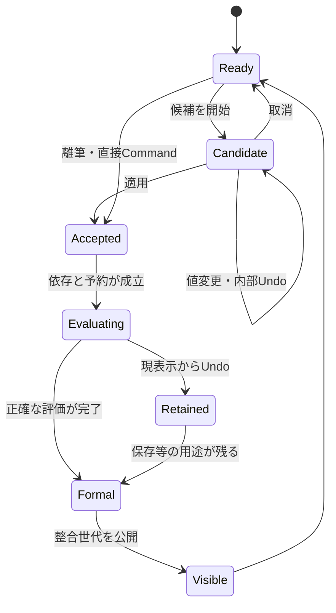

# 制作フロー・操作状態・交錯の契約

以下は製品の振る舞いの詳細設計。プロトタイプは入口と状態意味を模擬し、画像処理の正しさは別検証とする。

## 1. ラフ→線画→ベース色→陰影

1. Home「新規」CAN-001。寸法/単位/DPI/背景/色空間/深度を確認し作成。初回の安全条件はsRGB8。DPIだけの変更で画素数を変更しない。
2. BRU-001を左Railで選ぶ。対象帯に描画先、現在色、太さ。BRU-002/003/008を右のブラシまたは近接入口で調整。設定変更は既存ラフへ遡及させない。一筆一Undo。
3. LAY-001で線画層を追加。ラフをLAY-002で薄くして線を引く。接地後に別層を選んでも現在筆は開始層へ完了。次筆は新しい対象へ。
4. 色層を追加しFIL-003で「参照元＝線画、描画先＝色」を確認。FIL-001はタップ→候補→正式。漏れはFIL-002/009で直近調整、次筆を受理した後の修正は新Transaction。
5. 領域塗りを使う時だけLIN-001/002/006で仮想境界を確認。元線の更新LIN-005は旧色を維持し、候補の比較採用を要求。通常Fillまでこの準備を強制しない。
6. 陰影層を追加しLAY-004でClip、LAY-002で乗算。WET-001で混色。Clipや合成の意味を壊す最前面の仮線は使わない。

**中断条件**：筆の正式処理待ちだけで次筆、色、資料、Viewを止めない。同じ層のFill候補を未適用のまま描く時だけ局所的な「適用して描く／候補取消して描く／戻る」。保存要求自体は受け付ける。

## 2. 投げ縄→変形→変形後描画

1. SEL-001の投げ縄を選択。置換/加算/除外を開始前に表示。囲みは即時に出し、密度Maskは必要に応じて計算。途中取消で以前のSelection Maskへ戻る。
2. TRN-001/003で固定対象と原本を取得。ハンドル／メッシュはViewと一体に動く。内部Undoは直前のハンドル操作。重い場合は仮画像を先行し精細化中を表示。
3. 別レイヤーへ切り替え描いたCは独立に保持。変形Session取消でCを消さない。候補画像を採色・参照したCには依存を宣言し、独立と誤判定しない。
4. 適用は一作品Transaction。TRN-008で「変形後の見た目へ描く」が既定であることを対象帯で確認。元内容は保持し、その位置・筆幅で後段へ筆を追加。
5. 以前の変形を再編集する時は「後から描いた内容は自動追従しない」をその場に表示。全体へ新たな変形を追加する入口を併記。内容編集・別層・明示焼込は選択肢として保持する。

変形途中にHomeへ移動して戻っても対象・候補・内部Undoを失わない。未適用候補をPNGへ含めない。Native/Recoveryの保留状態とは別に説明する。

## 3. 資料→色補正→レイヤー整理→書き出し

1. REF-001で資料を追加。読込中/不足/再リンクを資料枠内に表示し作品を止めない。REF-002でピン・拡縮、REF-004の資料採色は色の出典を表示し元Toolへ復帰。
2. FX-103やFX-116を全機能カテゴリまたは検索から開く。対象レイヤー/Maskと効果順序を固定し候補Sessionへ。カーブの点、ぼかし半径等はそれぞれの固有設定を使う。汎用「強さ」だけへ潰さない。
3. LAY-003でGroup/並替。ドラッグのほか「上へ／下へ／移動先」を提供。複数選択の対象数と範囲を表示。LAY-005のMask編集は対象帯をMaskへ切替。元画素と混同しない。
4. HIS-003で別案を固定。SAV-003でNative保存を要求。完了前にも制作継続。表示は端末内保護と持出ファイルを区別する。
5. IO-002でPNG/JPEG/WebP、IO-007で色・メタデータ、IO-008で出力対象。UI、資料、Proof、View反転は通常の出力に含めない。Soloは明示選択。形式別の保持差はIO-003等で説明し、Native原本は保護。

## 4. 独立した状態機械

Viewの状態は上図と直積で共存する。画面移動をReady状態だけへ限定しない。未適用Session、現在の作品Revision、保存版、現在Focusはそれぞれ別軸。Candidate取消はそのSessionのみで、全Document rootを開始時へ戻すことではない。

| 軸 | 状態 | UIに必要な表示・入口 |
|---|---|---|
| Tool | 常用／一時／復帰先 | 現在Toolと一時状態。離す／終了で元へ |
| Session | なし／編集／適用待ち／失敗 | 対象名、適用、取消、内部Undo、再試行 |
| 作品 | 論理受理／依存待ち／正式評価済 | 未完件数と対象。受付と反映を別表示 |
| View | 静止／ナビ中／Focus／検査 | すべての途中寄与と同じ座標変換。作品Undo外 |
| 保存 | 要求／評価待ち／書込／確認／成功／失敗 | 対象版・保護先。成功後の変更あり。失敗は救出・再試行 |
| 資源 | 宣言／準備／使用中／停止／回収 | 機能検索では宣言だけ。読込の局所進捗 |
| UI | Panel開閉／検索／Context／IME | 戻り先Focus、入力所有、非同期更新でFocusを奪わない |

## 5. 交錯の受入表

| 入力順 | 維持する状態 | 禁止する結果 |
|---|---|---|
| 筆A処理中→指ナビ→次筆B | A/Bの入力は固定、正式FIFO、全寄与はViewに追従 | B欠落、Aが別層へ、指配送を無効化 |
| A未完→B受理→Undo | Bだけ現在枝から戻る。Aは継続 | 計算完了の遅いAから先にUndo |
| A未完→Save S→Undo A | 現作品は前へ、SはAを含む版を評価し保持 | SをUndo後の画像へ書換え、Aの全用途取消 |
| Undo A→新筆C→Aの遅い完了 | 現枝Cを維持、旧結果は必要な旧版へ | Aが現画面へ復活 |
| 変形候補→別層C→候補取消 | Cは残る、候補と内部Undoだけ破棄 | 開始rootへの全体巻戻しでCも消える |
| 候補値v1→v2→v1の遅い完了 | v2候補を表示、v1は公開しない | 古い計算が最新スライダー値を上書き |
| Save S1→Save S2→S1が遅く完了 | 最新保存先の世代はS2、S1結果は個別要求へ | ファイル最新版がS1へ逆転 |
| 保存中に容量不足 | 旧正常世代＋現在編集を維持、別コピーへ救出 | 未検証の半端な世代を保存成功と表示 |
| 文書A処理中→文書B | Aの世代/Job/保存はAへ帰属 | 同名レイヤーでBへ誤適用 |
| Workspace開閉／幅変更→Undo | 配置と作品履歴は別 | Panel開閉で一筆のUndo回数が変わる |
| IME変換中→キーUndo | IME/文字編集の所有へ | 変換候補と作品履歴を同時に戻す |
| Device loss／素材不足 | 正本保護、必要範囲再構築、局所の失敗表示 | 古いTextureや代替フォントを成功として保存 |

プロトタイプの状態モデル試験はこのうち論理関係の一部を検査する。正式画素、GPU世代、実ストレージ耐久性の試験の代用にはしない。
