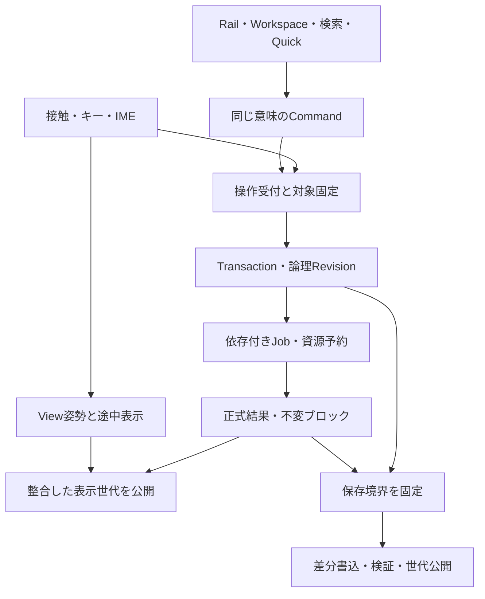

# 製品アーキテクチャ詳細設計

**設計案／論理境界。Worker数、GPUバックエンド、タイル寸法、実測性能の確定ではない。** PR #3 U01–U11を具体化し、PR #5の現行製品意味を優先する。

## 1. 実行と所有の分離

表示操作はJob完了待ちのCommandキューに並べない。接触サンプルごとに247機能のRegistryを探索したり、すべてのPanelへイベントを配送したりしない。Commandは意図単位で、strokeサンプルは開始時に取得した専用writerへ流す。

| 所有者 | 入力・出力と責任 | 禁止する結合 |
|---|---|---|
| UIProjection | Panel開閉・Focus・現在Tool・対象帯・検索。`describeAvailability`の軽い記述を表示 | 画素や保存成功をUIで推定しない。Panelを開くために全画像評価しない |
| InputRouter | pointer ID/生存世代/役割、実測サンプル、一時ToolとIME所有 | ペンを離した後に現在の層・色を読み直さない |
| ViewController | 画面姿勢の時刻対応、パン・ズーム・回転 | 作品Revisionを作らない。作品座標と画面座標を混ぜない |
| Admission | 文書/対象の生存世代、順序、read/write、必要版、予約可否の軽い検査 | 演算を同期実行しない。曖昧な対象を推測しない |
| History | 意図順Transaction、論理Revision/branch、Undo/Redo、Sessionと作品の別カーソル | 計算完了順を履歴順にしない。通常Undoで全筆再演しない |
| DocumentStore | 不変の層構造・正本タイル・原本/後段描画・パス/文字・Mask・色・資源参照 | GPU Textureや表示合成1枚を唯一の正本にしない |
| Evaluators | Brush/Fill/Selection/Transform/FX/Lineart/VectorText別の正確な評価 | 全機能を単一アルゴリズムへ強制しない |
| JobScheduler | 実行、依存待ち、予約、分割境界、取消要求、各用途の保持 | 未完筆を一般キャッシュとして破棄しない。GPUの割込み能力を仮定しない |
| Presentation | View＋公開正式結果＋仮寄与の一貫したsnapshot | 新正式結果と対応仮線削除を別の表示世代にしない |
| Persistence | SaveFence、pin、差分書込、manifest検証、先行正常世代保持 | 保存要求を後続Undoで書換えない。書出しを作品Undoにしない |
| Assets/Settings | 個人素材・ブラシ版・Workspace・キー設定、作品使用版の参照 | 名前一致で使っている素材を別版へ置換しない |

論理所有者は1 Worker＝1所有者という意味ではない。IPCコストが大きい専用経路を同じプロセスに置くことは可能だが、責務・版・結果公開条件は共有する。

## 2. 機能RegistryとCommand

247機能IDは製品カタログの識別子。`feature.TRN-001`等は**機能単位の名前空間**で、一つの巨大なexecute関数を要求しない。例えばTRN-001はstart/update/apply/cancel、LAY-001はadd/select、CAN-003はfit/100/flipView、CLP-001はcopy/cut/pasteへ分かれる。下位actionは同じfeature IDに紐付ける。検索・Rail・Quick・Context・キー・単指代替は同じaction IDと引数を渡す。

### 可否照会

`describeAvailability(contextSnapshot)`は文書・対象・能力・選択・Sessionの**小さな既知情報**だけを読む。結果はready／要対象選択／依存待ち／同対象Session衝突／機能範囲外／環境非対応。理由と代替入口を付ける。ヒストグラム、合成画像、全画素ハッシュを要求しない。正確な可否に重い確認が必要なら「確認が必要」を返し、実行時Jobで検査する。

### 操作の所有先

| 操作例 | Actionの意味 | Transaction・取消 |
|---|---|---|
| LAY-001 select / add | selectは編集対象UI状態、addは文書構造変更 | selectは作品Undo外、addは一Transaction |
| LAY-002 visibility / opacity / blend | 対象レイヤー属性変更。Solo検査LAY-009はView | ドラッグ一回を一Transaction。Soloは作品Undo外 |
| CAN-003 flipView / TRN-001 flipContent | 前者は見方、後者は作品内の変形 | 名前とアイコンの補足で区別。前者は作品Undo外 |
| BRU-002/008の値 | 次筆の設定。接地済筆は固定版のまま | 個人／プリセット設定。既存画素は変更しない |
| COL-006 assign / convert | assignは数値解釈変更、convertは色値変換 | 前後比較と対象ICC表示。一適用一Transaction |
| COL-008 proof | 表示用の検査変換 | 元色・採色・通常出力を変えない。View状態 |
| WET-005 selectPaper / reapply | 次筆の紙素材選択／既存作品へ明示再適用 | 前者は筆設定、後者は適用範囲を確認し一Transaction |
| SEL-001 create / SEL-008 hideBoundary | Selection Mask変更／境界表示だけ | 前者は選択履歴の意図単位、後者はView。両者を混同しない |
| CLP-001 copy / cut / paste | 内部移送、copyは元を維持 | copyは作品Undo外。cutは内部copy成功後のみ一削除Transaction。pasteは一挿入Transaction |
| SAV-002 trash / restore | 作品管理上の可逆削除／復元 | 作品画素Undoと別の管理履歴。ゴミ箱の完全削除は別境界 |
| SAV-003/IO-002 save / export | 固定した対象版を別保存先へ保護／完成画像へ | 作品Undo外。要求取消は保存Jobの用途を外すだけ |
| REC-001 record / REC-004 time | 任意記録OFF／端末内作業時間ON | 画素変更ではない。停止で既存記録を破棄しない |

各IDの固有パラメータ、表示、保持条件は[台帳](FEATURE_ACCESS_LEDGER.json)へ保持し、この表で一律のUndo意味へ上書きしない。`apply_cancel.kind`は主たるUIの所有分類であり、複数actionの全副作用を単一Undoへ潰す指定ではない。

## 3. 受理・Transaction・Revision

`IntentEnvelope`は文書ID/生存世代、対象ID/世代、operation ID、action、入力経路、座標契約、設定版、読取依存、write setを持つ。対象名は表示用で識別に使わない。admission時にresource tokenを確保するか、未受理の理由と救出導線を返す。

一筆の入力streamは接地で役割/設定/対象を固定、離筆で一Transactionの受理を閉じる。途中に指ナビや色変更があっても同じ筆の意味を保持。入力の予測サンプルは表示専用で、正式値へ無断混入しない。pointercancel・文書切替・接続喪失の時はINP-005の一筆全取消を基本候補とし、復旧の選択と原入力保持を分離する。

**論理Revision**は受理意図の根、**materialized root**は必要な正確な評価が完了した根。受理済で未完成のRevisionを完成画像とは呼ばない。UIは「受付済／精細化中／作品反映済／端末内保護済／ファイル保存済」を用途別に表示する。各完了は版を伴い、単一bool savedへ潰さない。

同一文書の正式筆A/B/CはFIFOで、Aの全タイル評価を終えてBへ進む。別レイヤーの筆だからといって追い越し方式へ変更しない。独立した資料やViewはこの筆列へ入れない。Fillや構造変更等はread/writeの競合を宣言し、前結果が必要なものだけ依存待ちにする。現在の仮画像を正式入力として誤用しない。

## 4. Jobと資源・取消

Job descriptorは入力版、出力域、必要入力域、入力変化の波及域、色/α、品質、最大一時容量の見積、分割/停止可能境界を持つ。見積不能な全域処理は全域予約の候補として扱い、局所haloで正確と装わない。正確な評価とプレビューはquality classを分ける。

用途参照は `currentView / descendantRevision / saveFence / snapshot / recovery / recorder / clipboard` の集合。UndoでcurrentViewから不要になっても、SaveFenceが必要とする評価は残す。`cancelled=true`一つで全用途を破棄しない。

処理中Undoは論理カーソルを先に移す。古いJob結果は必要なRevisionへ格納できるが、現表示へ再公開しない。新筆はUndo後の枝へ受理。RedoがUI上で消えたことと、固定案や保存中の旧枝を物理削除することは別。

予約は入力保持・表示・最古筆・保護へ進行余地を残す。任意解析/先読み/動画は抑制可能。GPUへ一括送信した長仕事を後から自由に中断できる前提は禁止。予約待ちで互いの完了資源を保持する循環待ちは作らず、部分確保の解放・再予約・専用の保護経路を定義する。

有限メモリで無限の入力を有界待ちにできる保証は置かない。退避も不可能なら、新しい編集を**受理する前**に対象を限定した理由を出す。既受理筆を捨てて見かけの即応性を作らない。ナビ・コピー救出の経路は残す。

## 5. 正本・表示・キャッシュ

正本はRasterタイル、パス、文字/書式、Mask、層構造、ICC、変形/効果定義、変形前原本、後段描画、作者が確定した境界判断、使用資源版。通常Undoは不変ブロックと正確な差分を共有する。GPU以外に再構成可能な正確な根がない割当を回収しない。

派生物はMip、変形評価、合成区間、glyph、サムネイル、未採用の領域候補。cache keyは入力版・設定・座標・順序・Group・Mask・下地・色/α・品質を含める。View移動は表示範囲/Mip需要を変えるが、作品の全画素再計算を意味しない。

上下二枚キャッシュは同値に合成できる区間にだけ適用。Multiply、通過Group、clip境界、階調依存合成、丸め順で意味が変わる場所は依存を保持した区間評価へ戻す。直近約5層や128/256pxは設計上の必須数値ではない。

### 監視UIの非侵襲契約

各所有者が進捗変化時にcounter／最古待ち／状態／版を更新する。UIは不変の `StatusSnapshot` を読む。通常のpointer・rAF・Panel開閉からrender/hash/diff/readbackを呼ばない。毎フレーム全DOMを再生成しない。値が変わった小領域だけ更新する。独立した全画素比較は明示検証Jobに分け、その負荷を通常性能の計測へ無言混入しない。

PR #6で確認されたのは小さいCPU Labのstatus()が毎回全再描画していた事実と修正版の試験結果。上記はそこから導く設計判断であり、GPU製品で同じ修正だけで改善するという推定ではない。

## 6. 仮線・正式結果・表示世代

仮寄与は対象層／Maskの論理位置へ差し込む。最前面のRGBA追加だけでは消しゴム、clip、上層Multiplyを再現できない。既存の合成意味を守れる専用プレビュー経路と、必要な区間だけの評価を比較する。

`PresentationSnapshot`は、公開根、可視仮寄与集合、各寄与の被覆、View姿勢、色変換、品質を一緒に指す。正式結果のGPU転送/準備が完了し検査された後、対応する正式参照追加と仮寄与除去を**同じ世代**へ公開。準備中の転送先を見せない。空白→本線の別フレーム、仮線＋本線の二重フレーム、crossfadeで半透明の濃度を変える方式を禁止する。

一筆一括公開を正しさの基準経路とする。部分タイル公開を最適化候補に残すが、排他的被覆・halo・筆順・採色/保存が見る正式版・部分取消を証明してから採用する。公開粒度の最終選定はUIレビューだけで閉じない。

## 7. 非破壊変形・色・線画

変形ノードは `source → transform → postPaint → laterTransform` の意味を保持する。既定の筆はDocumentの見た目位置へ後段描画。以前のtransform値だけを変更してもpostPaintは自動追従しない。再編集画面にその事実と「全体へ新しい変形／元内容編集／明示焼込」を示す。逆写像が一意でない歪みへ自動で書き戻さない。

色契約はsRGB/P3、8U/16U/16F、α/転送特性/合成式/量子化を明示。assignとconvertは別action。Display/Proof変換はDocument正本と別。未対応時は理由を出し8bitへ無言降格しない。正確な数式・誤差値は技術試験で閉じる。

線画原本、仮想境界候補、作者判断、確認済区分、Fill画素、Selection Maskを別正本として管理。元線更新で既存の塗り／選択を再配色しない。曖昧な候補を保留し、旧版由来を示す。通常色差Fillは位相解析モジュールの起動を必要条件にしない。

## 8. 保存・出力・起動

SaveFenceは要求時点のbranch/cursor、受理済離筆集合、取消状態、到達依存、色/出力条件、保存先世代を固定する。接地中筆と未適用Sessionは確定画像へ混入させず、Native/Recoveryの保留情報として明示的に分ける。画像出力では「直前の確定像／候補を先に適用／戻る」を示す。

保存順は、必要な正式結果を完成→変更ブロック/原本を書込→manifestと依存閉包を検査→完全世代を公開→保存先の確認条件を満たす→そのFenceの成功を通知。旧正常世代は新世代の確認まで残す。後続編集がある場合は「保存完了・その後の変更あり」。外部ファイルと端末内保護は別表示。並行Saveの最新先を完了順に逆転させない。

通常起動は保存済Rasterと編集原本を直接読む。クラッシュ後のみ不足区間の永続差分を適用。未記録の編集まで救出できるとは表示しない。codec・OPFS等の物理形式や原子性は未確定で、型案の `verified` は実際のストレージ能力が満たされた時だけ発行する。

## 9. 遅延起動

Registryは軽い宣言だけを起動時に登録。検索・カテゴリ表示ではAIモデル・codec・領域解析をロードしない。実行需要により準備→ready→active→停止→再生成可能資源回収。使用中ライブ効果はPanelを閉じても未使用ではない。受理済入力、編集中原本、SaveFenceが参照する資源を停止処理で消さない。

技術候補と代替・欠点・検証条件は[検証計画](VALIDATION_AND_DECISIONS.md)へ接続する。
